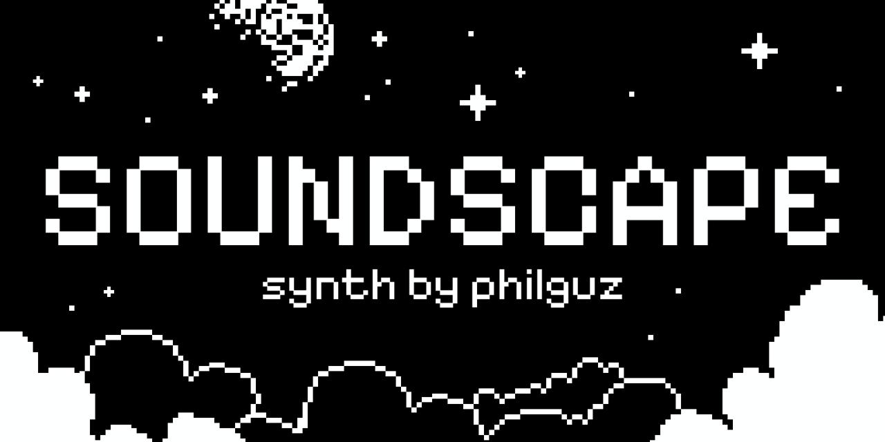
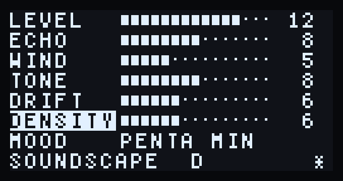

# Midiboy Soundscape Synth



Midiboy Soundscape turns a [Blokas Midiboy](https://blokas.io/midiboy) into a little
ambient machine. Switch it on and it starts playing: a slow, drifting pad, a bit of wind,
and the occasional chime with an echo trailing behind it. It never plays the same thing
twice, and it's happy to run for hours in the background while you work, read, or fall
asleep.

The Midiboy has no audio output and Midiboy Soundscape makes real audio
anyway and sends it out of the **MIDI OUT** port. A cheap DIN-to-jack adapter gets it into
your mixer, audio interface, or recorder.

**Highlights**

- Four layers that drift on their own: a warm pad with wandering chords, wind with gusts,
  bell-like chimes, and an echo on the chimes.
- Eight moods (scales), from pentatonic to whole tone.
- A handful of knobs-as-buttons: how busy, how restless, how bright, how windy, how much
  echo, and how loud.
- Press **A** for a fresh random scene whenever you like.
- Melody mode, which loops a tune on the bells. You can turn your own MIDI file into one.
- Leaves your Midiboy's saved data alone, so other sketches' patterns survive.

**Lowlights**

- It's a lo-fi 8-bit instrument with a 15.6 kHz sample rate. Think music box in the fog,
  not studio synth.
- It's a standalone sound source. USB MIDI doesn't work while it plays, and it doesn't
  respond to MIDI input.
- Settings aren't saved. Every start-up begins fresh.

## What you need

- A Blokas Midiboy.
- A TRS MIDI adapter, **Type A**, from 5-pin DIN to a 3.5 mm jack.
- Something with a line input: an audio interface, mixer, recorder, or powered speaker
  with a line in.

> **Don't plug in headphones directly.** The signal needs an amplifier and DC blocking
> first, and headphones won't get either from the Midiboy.

## Getting started

1. Flash the firmware onto the Midiboy. See [Build](docs/DEVELOPMENT.md#build) and
   [Flash the Midiboy](docs/DEVELOPMENT.md#flash-the-midiboy).
1. Plug the DIN end of the adapter into **MIDI OUT**, and the jack end into your line
   input. The sound is mono and arrives on the left channel of a stereo input.
1. Turn your input gain down, switch on the Midiboy, and bring the gain up slowly. The
   sound starts right away.
1. Press **A** a few times to hear different scenes, then play with the parameters.

## Playing it



The screen shows a title row and one row for each parameter. Use **Up** and **Down** to
pick a row, and **Left** and **Right** to change it. Hold **Left** or **Right** to change
a value faster.

- **A** starts a new scene with a new root note and chord. In melody mode, it restarts
  the melody.
- **B** holds the current chord, while everything else keeps drifting. `HOLD` appears on
  the title row.

The title row at the bottom also shows the mode and the root note, and a `*` flashes every time a bell
strikes.

| Parameter | What it does |
|---|---|
| Mode | **SOUNDSCAPE** is the endless generative scene. **MELODY** loops a tune. |
| **MOOD** | The scale: PENTA MIN, PENTA MAJ, DORIAN, LYDIAN, AEOLIAN, HIRAJOSHI, IN SEN, or WHOLE TONE. The pad glides into the new one. |
| **DENSITY** | How often chimes strike, from never (0) to about every 20 seconds (1) to a couple of times a second (15). |
| **DRIFT** | How restless everything is. Low values change chords about every 30 seconds, high values every 8. |
| **TONE** | How bright and resonant the pad sounds. |
| **WIND** | How much wind. 0 turns it off. |
| **ECHO** | How much echo on the chimes. 0 turns it off. |
| **LEVEL** | Master volume. Even at 15 it stays at a safe level for a line input. |

All parameters except Mode go from 0 to 15.

## Melody mode

Select **MELODY** on the title row, and the scene moves into the melody's key. The tune
plays on the bells, its low notes steer the pad, and it loops with a short rest at the
end. Switch back to **SOUNDSCAPE**, and the scene carries on in that key.

Out of the box, it plays a short original phrase. To use your own tune, convert a MIDI
file with the included script, then build and flash again:

```sh
python tools/mid2melody.py song.mid
```

Simple melodies work best. For how the conversion works and its options, see
[Melody converter](docs/DEVELOPMENT.md#melody-converter).

## More documentation

- [Development](docs/DEVELOPMENT.md): how it works, building, flashing, debugging, and the
  code layout.
- [Design decisions](docs/DESIGN.md): why it's built the way it is.
- [Measurements](docs/MEASUREMENTS.md): output level, audio quality, pitch accuracy, and
  CPU use.

## License

[MIT](LICENSE), except for a few parts derived from [Mozzi](https://github.com/sensorium/Mozzi),
which stay under LGPL. See
[Licensing of derived code](docs/DEVELOPMENT.md#licensing-of-derived-code) for details.